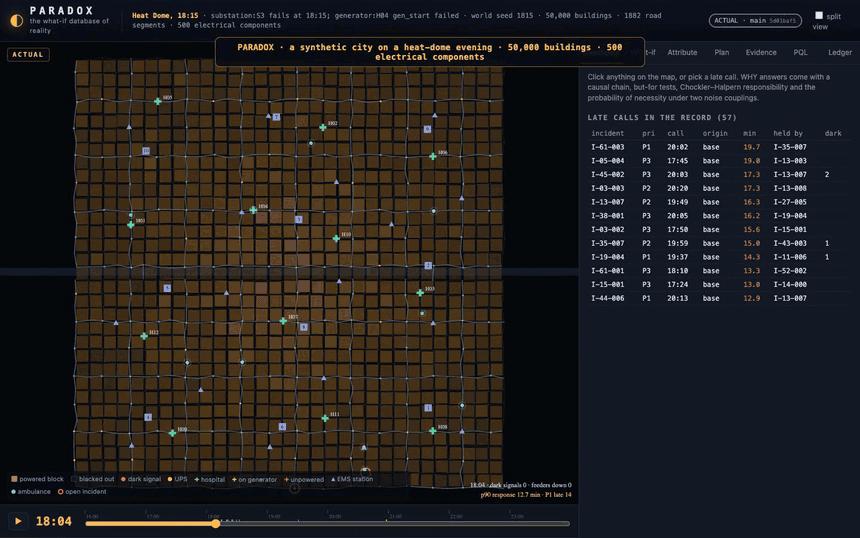
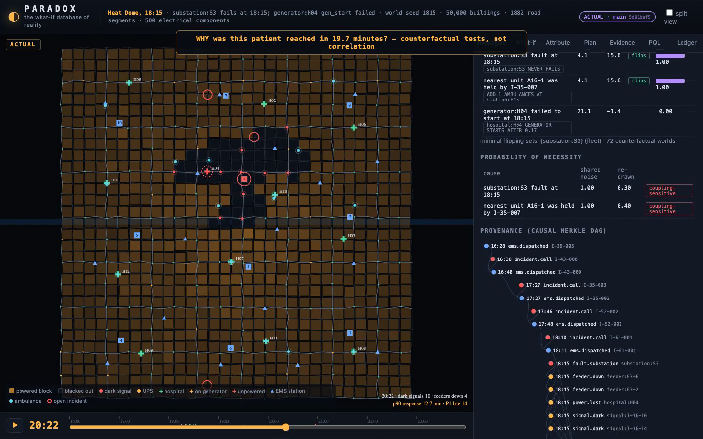
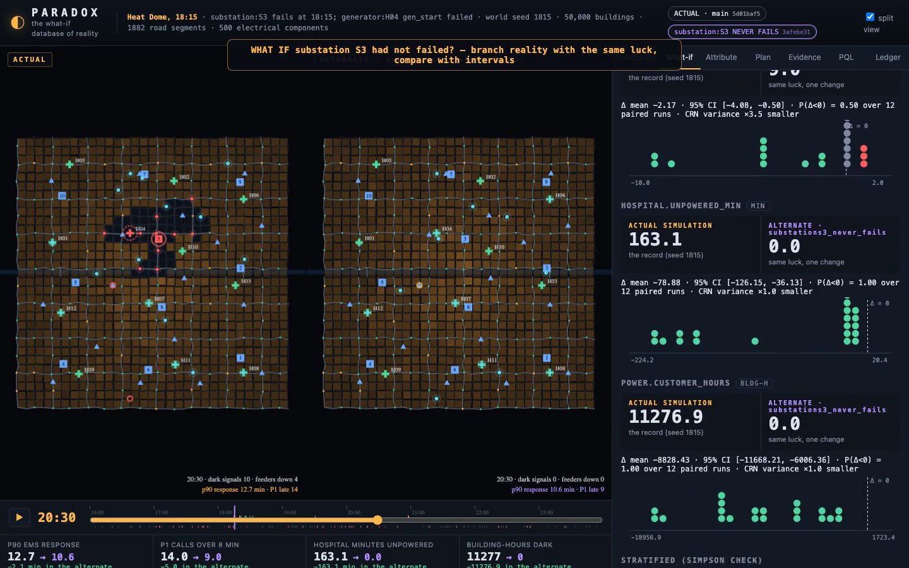
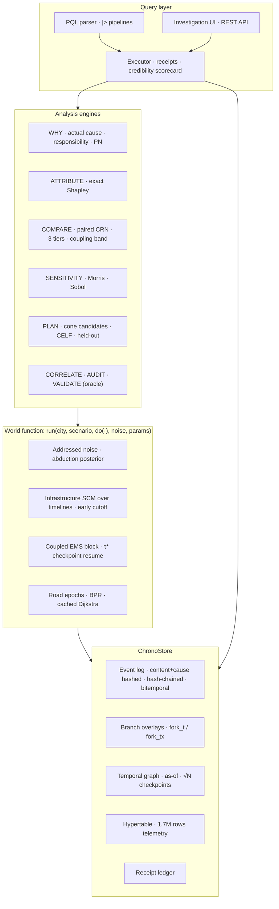
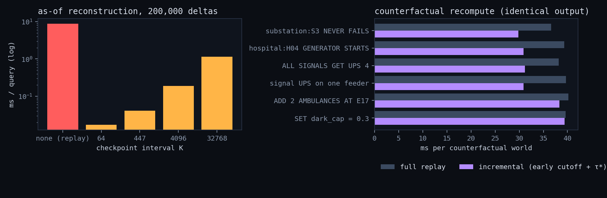

<div align="center">

# ◐ PARADOX

### The What-If Database of Reality

**A causal-temporal database that stores what happened, explains *why* it happened,<br>
and lets you branch reality to ask what would have happened if one thing had been different.**




**▶ [Watch the full 1:44 demo video](#-demo-video)** · [Problem analysis](docs/PROBLEM.md) · [Deep analysis (13 research streams)](docs/ANALYSIS.md) · [Architecture](docs/ARCHITECTURE.md) · [Research & parameters](docs/RESEARCH.md)

</div>

## ▶ Demo video

The full 1:44 walkthrough runs a blackout at 18:15, a WHY query, a branched alternate reality in split view, the AUDIT that finds the hidden fuel-pump dependency, a plan, a PQL query and a verified receipt.

https://github.com/user-attachments/assets/ccb4e423-afef-47b2-81ec-10c58df4f6d7

<sub>Can't play it? [Download the MP4](docs/media/paradox-demo.mp4). Re-record it with `scripts/record_demo.cjs`.</sub>

---

> A normal database can tell you: *"At 18:15 substation S3 reported a fault."*
>
> PARADOX can tell you:
> * which hospitals, traffic signals, ambulances and patients were downstream of that fault, **as the dependency graph existed at 18:40**;
> * **why** patient `I-61-003` waited 19.7 minutes instead of 4.1;
> * **what would have happened** had S3 held, or had hospital H04's generator started, with the same luck and the same callers, and with honest intervals;
> * **which of its own assumptions** the answer hinges on;
> * the **cheapest change** that would have kept the 90th-percentile response under 11 minutes, scored on evenings the optimiser never saw.
>
> It also tells you **when it is probably wrong**. In the demo, it discovers on its own that a hospital's fuel pump is wired to the wrong electrical bus, a dependency its model does not contain.

**Everything is synthetic.** The city, the infrastructure and every number are simulated. Model parameters come from the literature where possible and are tagged as assumptions where not. Every counterfactual is *model-relative*. This is a research prototype about how to build such a system honestly, not a validated model of any real place.

---

## Contents

1. [Thirty seconds of PARADOX](#1-thirty-seconds-of-paradox)
2. [Why this is a 10/10 problem](#2-why-this-is-a-1010-problem)
3. [How the problem was attacked: 13 research streams](#3-how-the-problem-was-attacked-13-research-streams)
4. [Architecture](#4-architecture)
5. [Seven ideas that make it work](#5-seven-ideas-that-make-it-work)
6. [Results: the Heat Dome evening](#6-results-the-heat-dome-evening)
7. [How wrong is it? Validation against a hidden reality](#7-how-wrong-is-it-validation-against-a-hidden-reality)
8. [Benchmarks](#8-benchmarks)
9. [PQL: the PARADOX Query Language](#9-pql-the-paradox-query-language)
10. [Quickstart](#10-quickstart)
11. [Repository map](#11-repository-map)
12. [Limitations and what I would do next](#12-limitations-and-what-i-would-do-next)
13. [References](#13-references)

---

## 1. Thirty seconds of PARADOX

```bash
pip install -e .            # numpy, scipy, networkx, fastapi, uvicorn
paradox serve               # → http://127.0.0.1:8642
```

```sql
-- the dependency graph as it existed at 18:40, not as it is now
AS OF 18:40 SHOW DEPENDENTS OF substation:S3 DEPTH 2

-- causal explanation with but-for tests, responsibility and probability of necessity
WHY incident:I-61-003

-- branch reality: same luck, one change, paired uncertainty, coupling check
WHAT IF substation:S3 NEVER FAILS COMPARE ems.p90_response, ems.p1_late RUNS 24 COUPLING

-- the excess, split fairly among root causes (exact Shapley)
ATTRIBUTE ems.p1_late

-- smallest affordable fix, scored on held-out evenings
PLAN REDUCE ems.p90_response BELOW 11 BUDGET 60

-- the twin audits itself against a hidden reality
AUDIT

-- bitemporal: what did we believe before the correction?
CORRECT substation:S3 FAULT TIME TO 18:12
AS OF 18:20 KNOWN AT 1 SHOW EVENTS OF substation:S3
```

<table>
<tr>
<td width="50%"><br><sub><b>WHY</b>: decomposition against the root-free world, ranked causes, coupling-sensitive probability of necessity, and the causal Merkle DAG that links a held ambulance back through earlier calls to the 18:15 fault.</sub></td>
<td width="50%"><br><sub><b>WHAT IF</b>: the ACTUAL evening (left, S3 blacked out) next to the ALTERNATE branch (right), synchronised in time. Paired deltas are shown as quantile dotplots, never as bare numbers.</sub></td>
</tr>
</table>

---

## 2. Why this is a 10/10 problem

A conventional database answers **rung 1** of Pearl's ladder of causation (*what happened, what co-occurred*). PARADOX makes **rung 2** (*what if we do X*) and **rung 3** (*given what actually happened, what would have happened under X*) **queryable**. Rung 3 is the strange one. It is not "simulate a world without the failure"; it is "simulate *the same* world, with the same callers and the same coin flips, except for the failure".

[`docs/PROBLEM.md`](docs/PROBLEM.md) breaks the brief into eight hard sub-problems. Each one became a design constraint:

| # | Hard sub-problem | What naive systems get wrong | PARADOX's answer |
|---|---|---|---|
| H1 | **Counterfactual coherence**: "the same luck" | a sequential RNG drifts once the alternate path diverges, so you end up measuring noise instead of cause | **addressed noise**: every draw is a pure function of *what it is for*, and the alternate world reuses it |
| H2 | **Branching without corrupting reality** | copying logs, or editing history | **causal Merkle DAG** event store with copy-on-write branch overlays |
| H3 | **Recompute only what changed** | full replays, or "incremental" shortcuts that silently diverge | timeline SCM with **early cutoff** and EMS **τ\* resume**, *tested identical to full replay* |
| H4 | **Dependencies change over time** | a static graph | **temporal graph** with interval edges and as-of reconstruction |
| H5 | **Causation vs correlation** | dashboards show correlations | modelled-path check, **confounder detection** (d-separation plus stratification), **knockout** evidence |
| H6 | **Counterfactuals cannot be validated** | a confident "14 min" | **oracle harness** against a hidden reality; every answer carries a scorecard and a disclaimer |
| H7 | **Uncertainty is not one thing** | a single CI | **three tiers**: Monte Carlo, assumptions, structure. Plus a **coupling band** |
| H8 | **Smallest fix** | greedy on in-sample numbers | causally pruned **CELF**, irreducible pruning, **held-out** scoring |

---

## 3. How the problem was attacked: 13 research streams

Before any engine code, the problem went through **three literature passes** and then **ten parallel deep-dive analyses**, each run as an independent research agent with its own brief. The synthesis is [`docs/ANALYSIS.md`](docs/ANALYSIS.md). Each stream ends in numbered design decisions that the code cites.

| Stream | What it found | What it changed |
|---|---|---|
| **Causal theory** | abduction–action–prediction; counter-based RNG keyed by event identity; Gumbel-max for stable choices | `NoiseTape`, typed addresses, and `Posterior` (truncated-posterior abduction) |
| **DB systems** | XTDB/SQL:2011 bitemporality; Dolt prolly trees; DeltaGraph snapshots; Adapton cutoff; provenance semirings | the `ChronoStore` contracts |
| **Domain** | NFPA 110 (10 s transfer); generator failure-to-start 1.5% normally, 6% under stress (ASHE); BPR; dark signal ≈ all-way stop at about 40% capacity | the parameter registry with S/D/A tags |
| **DB prior art** | HypeR (causal but static), Mahif (history but no causality), MCDB/SimSQL (stochastic but not causal), Tiresias (how-to, deterministic) | the gap PARADOX fills: **time-unrolled, per-instance, branchable, uncertain causal queries** |
| **Real cascades** | 2003 NE, 2019 Manhattan, **Sandy 2012 (Bellevue fuel pumps in the basement)**, Uri, Ida, **Iberia 2025** (telecom second wave) | common-mode fuel pumps, battery clocks, the hidden-reality design |
| **Red team** | 12 ways to be confidently wrong, e.g. noise misalignment, Simpson's paradox, forking paths, optimiser's curse, forgeable provenance | most features in §5 and §7 exist because of this list |
| **Evidence** | Hawkes and PCMCI screens; d-separation; GRADE- and ICD-203-style evidence grades | `CORRELATE`, `AUDIT`, grades A–X |
| **V&V** | Sargent; ODD; NASA-STD-7009B; ASME V&V40; Galles–Pearl axioms as tests | 20+ axiom and property tests, the credibility scorecard |
| **Planning** | FLISR, signal UPS, generator docks and maintenance, MEXCLP, CELF, OCBA, the optimiser's curse | the action catalogue and held-out scoring |
| **Language and UX** | SQL:2011 `AS OF`, XTQL pipes, Pirolli–Card sensemaking, HOPs, quantile dotplots (Kay et al.) | PQL, linked views, dotplots instead of bare numbers |
| **Performance** | multi-source Dijkstra is about 20× faster; per-event Python dominates the cost | road-epoch cache (99.7% hit rate), vectorised telemetry |
| **EMS fidelity** | 2003 NYC blackout: EMS calls **+58%**, respiratory **×2.9**; the Erlang-C knee near ρ≈0.75 | outage-induced demand, the queueing sanity test |
| **Design review** | line-level bugs in the first draft: single-interval visibility, a non-atomic correction, a genesis hash that committed to the wrong parent state | fixed, with regression tests |

---

## 4. Architecture



The brief suggested a polyglot stack (PostGIS, Neo4j, TimescaleDB, an event store, a scenario store, a provenance store). PARADOX instead implements **one embedded engine** whose layers *are* those stores, because the research content lives in the **contracts between them**: event identity, branch semantics, as-of semantics and provenance pinning. `paradox export` then maps the engine onto the production stack: PostGIS/Timescale DDL with a recursive `branch_events()` SQL function, and Neo4j Cypher with interval-valued edges.

| Brief's layer | PARADOX layer | Core idea |
|---|---|---|
| PostgreSQL + PostGIS | `city` registry | entities, geometry, static attributes |
| Neo4j | `TemporalGraph` | typed edges (Rinaldi classes) with validity intervals |
| TimescaleDB | `Hypertable` | time-chunked columnar telemetry, chunk pruning, incremental rollups |
| Event store | `ChronoStore` log | content+cause addressed, hash-chained, bitemporal intervals |
| Scenario store | branch overlays | copy-on-write timelines that share every unaffected event |
| Provenance store | causes + receipts | every event knows its causes; every answer is pinned to branch heads |

---

## 5. Seven ideas that make it work

### 5.1 The causal Merkle DAG
An event's id is the hash of its content **and of its causes' ids**:

```python
eid = blake2b_128(canonical([t, kind, entity, attrs, sorted(causes), rule]))
```

So **two timelines share an event iff they share its entire causal past**. Diffing two branches is a set difference, and that difference *is* the causal footprint of the intervention. No diff algorithm is needed. For `S3 NEVER FAILS`, the branch forks at 18:15, shares 419 events with reality, erases 315 and adds 234. Branch hash chains have a genesis that commits to the parent's chain at the fork. `VERIFY` re-hashes every object and every link.

### 5.2 Addressed noise and exact abduction
Every random number is `u = H(seed, address)`, and the address names *what the draw is for*: `("generator:H04", "gen_start", <root fault id>)`, `("I-12-007", "scene")`. The tape records what each draw *revealed*:

* continuous draws reveal a **point**;
* threshold draws reveal only a **side**, the interval `u ∈ (0, p)` or `[p, 1)`.

`Posterior(tape, r)` gives replicate *r*. Points stay fixed, intervals are **re-sampled inside the interval**, and unobserved addresses are drawn fresh. This is Pearl's abduction step, done exactly, and it produces a *probability-of-necessity* answer with no special-casing:

> The record says H04's generator **failed to start** (p = 0.06, so u ∈ (0, 0.06)). Under `GETS MAINTENANCE` (p → 0.01) it still fails whenever u < 0.01, which is 1/6 of the posterior. PARADOX measured it failing in **15%** of 48 posterior replicates. Theory says 16.7%.

Two subtleties found and fixed along the way:
* Episodic noise is keyed by the **root fault**, never by an occurrence count, so removing one outage cannot shift another's luck.
* Counterfactual runs use a **non-writing fork** of the factual tape. Otherwise their draws would leak into the record and silently shrink the posterior.

### 5.3 A structural causal model over *timelines*
Each infrastructure component's state is an interval set whose endpoints carry the ids of the events that caused them. Structural equations are written in that algebra:

```
hospital unpowered = grid_lost ∩ generator_unavailable(start, restart, day-tank fuel)
diversion          = unpowered ∪ delay_onset(water_lost, 45 min)
```

Nodes run in topological order with **early cutoff**: a node is reused if no intervention touches it and its parents' digests match the baseline.

The EMS layer cannot cut off per incident, because ambulances couple incidents. So it is **one block** that computes **τ\***, the first instant any of its inputs diverge, keeps every incident whose whole lifecycle ended before τ\*, rebuilds fleet state and simulates the rest.

**Every incremental world is tested event-for-event identical to a full replay**: 27 intervention sets × 3 seeds, plus posterior replicates.

### 5.4 Bitemporality and overlays
Valid time (`t`) and transaction time (`tx`) are separate. Visibility is a list of `(assert_tx, retract_tx)` intervals, and corrections are atomic. A branch reads `parent[t < fork_t, known_at ≤ fork_tx] ∪ own`, so late corrections to reality never leak into a what-if that was computed under the old belief. `AS OF 18:20 KNOWN AT 1` answers *what did we believe then?*

### 5.5 Uncertainty, decomposed, never a bare number
Every what-if is a **paired** ensemble with common random numbers:

* **rung 3 (default)**: posterior replicates of *this* evening;
* **rung 2**: fresh evenings with the same faults.

Three tiers of uncertainty:
1. Monte Carlo;
2. Monte Carlo plus a Latin-hypercube draw of every assumption-tagged parameter;
3. structural error, measured separately by `VALIDATE`.

A **coupling band** re-draws per-incident service noise, because rung-3 answers depend on an unidentifiable noise coupling (Cornish et al., JMLR 2026), and PARADOX says so.

> **An honest surprise.** With the record fully observed and shared coupling, the rung-3 answer to `S3 NEVER FAILS` **collapses to a point**: Δp90 = −2.11 min, zero spread. Every draw it needs was observed. PARADOX does not invent a confidence interval for it. It reports that the remaining uncertainty lives elsewhere:
> * **assumptions:** −3.02 [−4.86, −1.59];
> * **coupling:** re-drawn service noise gives −4.37 [−5.89, −2.94], so the result is flagged **coupling-sensitive**;
> * **other evenings:** rung 2 gives −4.04 [−6.08, −2.22].

### 5.6 WHY, with formal causes
`WHY incident:X` decomposes the response time against the **root-free world**, then walks the provenance DAG. It ranks candidates (root events plus on-path conditions such as *the nearest unit was held by I-35-007* or *the route crossed dark signals*) by but-for effect, **minimal flipping sets** and **Chockler–Halpern responsibility**. It estimates the **probability of necessity** under both couplings. Blame attaches to components and conditions, never to people.

### 5.7 Evidence: catching your own blind spots
* **`CORRELATE`** runs randomised-fault natural experiments, checks the dependency DAG for a modelled path, then finds common ancestors and a **minimal d-separator**, and re-measures within strata.
  * *H04 lost power ⟷ signal I-16-12 went dark*: φ = 1.00 overall, **0.00 within strata of S3**. Verdict: confounded, no modelled path.
* **`AUDIT`** stress-tests every hospital and runs a **sign test** on prediction residuals. It localises the missing mechanism from the observed provenance and **confirms it with a knockout** in reality (§7).

---

## 6. Results: the Heat Dome evening

**The record.** A synthetic city of 577,085 residents; world seed 1815, committed before any outcome was seen.

At 18:15 a transformer fault takes **substation S3** offline during a heat dome:
* **Power:** six feeders drop. Two are rescued by tie switches within 5–10 min (T07, T04). **Four are blocked**, because heat-dome loading has eaten the neighbours' headroom.
* **Traffic:** 13 signals go dark.
* **Hospital:** H04's generator **fails to start**, as observed in the incident record. The manual restart also fails, so H04 is unpowered and on diversion for **163 min**.
* **EMS:** ambulances, already near the queueing knee, start to queue.

| KPI (16:00–24:00) | Record | No-fault world |
|---|---|---|
| EMS p90 response | **12.7 min** | 10.6 min |
| Priority-1 calls over 8 min | **14** (45%) | 9 |
| Hospital-minutes with no power | **163** | 0 |
| Building-hours dark | **11,277** | 0 |

**What-if answers** (24 paired posterior replicates, MC + parameter tier):

| WHAT IF … | Metric | Δ mean | 95% CI | P(Δ<0) | Note |
|---|---|---|---|---|---|
| `substation:S3 NEVER FAILS` | p90 response | −3.02 min | [−4.86, −1.59] | 0.79 | stronger in the affected area (−4.24) than elsewhere (−2.81) |
| | P1 late | −3.08 | [−4.25, −2.00] | 0.67 | CRN variance ×5.9 smaller |
| `hospital:H04 GENERATOR STARTS AFTER 0` | hospital minutes unpowered | −65 | [−95, −39] | 1.00 | p90 barely moves (−0.02): the EMS harm is not about H04 |
| `hospital:H04 GETS MAINTENANCE` | hospital minutes unpowered | −139 | [−153, −122] | 0.85 | still fails in 15% of the posterior (truncated abduction) |
| `ALL FEEDERS GET FLISR` | building-hours dark | −491 | [−670, −322] | 1.00 | p90 unchanged: **automation cannot create capacity** the heat dome removed |

**Attribution** (exact Shapley over root events):

| Metric | Excess | S3 fault | H04 failed start |
|---|---|---|---|
| p90 response | +2.11 min | 98% | 2% |
| P1 late | +5 calls | 80% | 20% |
| hospital minutes unpowered | +163 | 50% | 50% (pure interaction: neither alone causes it) |

**WHY `incident:I-61-003`.** A priority-1 call at 20:02 was reached in **19.7 min**. In the nominal world the same patient is reached in **4.1 min**.
* **Where the time went:** travel +13.8 min, because the nearest unit A16-1 was still committed to I-35-007 and a farther one came. Queueing added +1.9 min.
* **Minimal flipping sets:** `{substation:S3}` and `{fleet}`, each with responsibility 1.0.
* **Probability of necessity:** 1.00 under shared noise against **0.30** with re-drawn service noise. That gap flags the verdict as **coupling-sensitive**, and PARADOX says so in the answer.
* **Cost:** 72 counterfactual worlds, about 2.5 s.

**PLAN `REDUCE ems.p90_response BELOW 11 BUDGET 60`.** The planner offers 21 candidates from the causal cone; CELF chose the plan below.

| Plan | Cost | Held-out p90 | P(meet target) | Optimism gap |
|---|---|---|---|---|
| no action | 0 | 17.8 min | 0.19 | — |
| **+2 reserve ambulances at E17, E13, E09** (any action) | 9 CU | **8.6 min** (Δ −9.2 [−14.1, −4.9]) | **1.00** | 8.7 min |
| UPS on the dark signals of 4 feeders (capital only) | 10 CU | 14.9 min | 0.25 | 1.5 min |

At the queueing knee, *capacity* beats *hardening*. The **optimism gap** column shows the optimiser's curse directly: in-sample, the surge plan looks 8.7 min better than it really is. That is why PARADOX only reports held-out numbers.

**SENSITIVITY `ems.p90_response`** (Morris, 23 assumption-tagged parameters). The top three parameters are all about **demand at the queueing knee**, not infrastructure:
1. heat-dome demand multiplier (μ\* 16.0);
2. respiratory surge (11.6);
3. respiratory onset delay (11.5).

The answer is most sensitive to the parameters the literature pins down least.

---

## 7. How wrong is it? Validation against a hidden reality

No counterfactual can be checked against the real world. A synthetic city allows something no real twin can: build a **hidden reality** that differs from the twin, then grade the twin against that reality's *true* counterfactuals.

The hidden reality has four differences:
1. **A Bellevue-style common-mode dependency.** H04's fuel-transfer pump is on the *normal* bus, not the emergency bus. Its generator starts, the day tank runs dry about 1.3 h later, and the pump cannot refill it. This is the Sandy 2012 failure mode.
2. Generators fail to start more often (0.10 vs 0.06).
3. Dark intersections keep less capacity (0.33 vs 0.40), with more spillback.
4. Crashes at dark signals are more frequent.

**`VALIDATE`**: 10 scenarios × 3 interventions × 2 metrics, with the twin's 90% interval from the parameter tier.

| Metric | Cases | Empirical 90% coverage | Mean abs. error |
|---|---|---|---|
| EMS p90 response | 30 | **90%** | 1.18 min |
| hospital minutes unpowered | 30 | **93%** | 5.4 min |

On aggregate the intervals look calibrated, and **that is the trap**. One case, the S3 scenario, is off by **158 minutes**: the twin's interval is [0, 0] and the truth is −158. That is precisely where the twin's *structure* is wrong, which no parameter interval can see.

**`AUDIT`** catches it:
1. **Residual screen.** Every hospital is stress-tested 4×. H04 is unpowered **+159 min** longer than predicted in **8/8** episodes; sign test p = 0.004. Grade **X (model contradicted)**.
2. **Localisation.** Reality's provenance shows an event the twin never predicts, `gen.fuel_exhausted`, caused by `feeder:F3-6`. The suspected hidden dependency is `feeder:F3-6 → fuelpump:H04 → generator:H04`.
3. **Knockout.** `hospital:H04 GETS FUEL BACKUP` in reality takes unpowered time from 145.5 to **0** min. Grade **D: a hidden dependency, discovered, knockout-confirmed, missing from the model.**

Every what-if answer carries a **credibility scorecard** in the spirit of NASA-STD-7009B and ASME V&V40. Its *input pedigree* row is permanently capped at 1, because the city is synthetic, and the verdict always reads **EXPLORATORY**. Each what-if also runs live checks: the incremental world must equal a full replay, and the posterior's factual arm must reproduce the record.

**What PARADOX does not claim.** It is not a model of any real city. Counterfactuals are model-relative. Intervals cover Monte Carlo and parameter uncertainty, not structural error; that is what §7 measures. The parameter tier is a *sensitivity analysis*, not a posterior, because it does not condition parameters on the record.

---

## 8. Benchmarks

`python -m benchmarks.run` on an Apple-silicon Mac (Python 3.12, numpy 2.1). Medians of repeated runs. Raw numbers: [`benchmarks/results.json`](benchmarks/results.json).



| Layer | Measurement | Result |
|---|---|---|
| Event store | content+cause hashing / batch ingest / branch read / full re-verify | 151k / 317k / 4.2M / 124k events·s⁻¹ |
| Temporal graph | as-of reconstruction, 200k deltas: replay vs √N checkpoints | 8.8 ms → **0.041 ms** (≈215×) |
| Hypertable | 1.73M rows · ingest · pruned 30-min range query (1 chunk scanned) | 19M rows·s⁻¹ · 0.005 ms |
| World | full world simulation (282 SCM nodes, ~140 incidents, ~600 events) | ~22 worlds·s⁻¹ |
| Routing | road-epoch cache hit rate across branches and replicates | **99.7%** |
| CRN | variance reduction from pairing (rung 2) | ×4.1 – ×15.6 |
| Counterfactual | incremental vs full replay, **identical output in every case** | 1.0 – 1.3× |

**On that last row, honestly.** Incremental recompute is *correct* (event-for-event identical, and tested), but at this scale it is only 1.0–1.3× faster. Two reasons:
1. The shared road-epoch cache already removes the expensive shortest-path work from full runs.
2. Every scenario intervention diverges at 18:15, so about 75% of the coupled EMS block must be re-simulated anyway.

The infrastructure SCM does reuse 93–281 of 282 nodes. Big wins would need finer-grained EMS memoisation (§12).

---

## 9. PQL: the PARADOX Query Language

```ebnf
query  := [AS OF time [KNOWN AT int]] [IN branch] stmt { "|>" stmt }
stmt   := SHOW (DEPENDENTS|DEPENDENCIES) OF ref [DEPTH n] | SHOW STATE OF ref | SHOW EVENTS [OF ref] [FROM t TO t]
        | SHOW (KPIS|BRANCHES|PARAMS|CITY|RECEIPTS|INCIDENTS [LATE]|TELEMETRY OF ref [METRIC m])
        | WHY [NOT] ref | WHAT IF iv {AND iv} [AS name] [COMPARE m {, m}] [RUNS n]
              [MODE COUNTERFACTUAL|INTERVENTIONAL] [TIER MC|PARAMS] [COUPLING]
        | ATTRIBUTE metric | PLAN REDUCE metric BELOW x [BUDGET b] [USING capital|operational|programme]
        | SENSITIVITY metric [METHOD MORRIS|SOBOL] [RUNS n] | CORRELATE ref WITH ref | AUDIT | VALIDATE
        | DIFF branch [WITH branch] | VERIFY branch|receipt | TRACE ref | CORRECT ref FAULT TIME TO t
iv     := ref NEVER FAILS | ref FAILS AT t [FOR m] | ref REPAIRS IN m | ref [GENERATOR] STARTS [AFTER m]
        | ref GETS (FLISR | UPS h | BATTERY h | MAINTENANCE | FUEL BACKUP) | ADD n AMBULANCES AT ref
        | SET param = x | ALL (SIGNALS GET UPS h | FEEDERS GET FLISR | TOWERS GET BATTERY h | HOSPITALS GET MAINTENANCE)
```

Pipelines run the next verb *inside* the branch the previous one created:

```sql
WHAT IF hospital:H04 GENERATOR STARTS AFTER 0 |> WHY incident:I-61-003
```

Every result carries a header (branch, as-of, known-at, tx) and a **receipt**. A receipt records:
* the branch heads and `known_at`;
* the code, model and parameter digests;
* the seeds and the coupling;
* how many what-ifs the session had explored before it (the garden of forking paths, made visible).

---

## 10. Quickstart

```bash
git clone https://github.com/amartya1523/PARADOX.git && cd PARADOX
pip install -e ".[dev]"
```

```bash
paradox serve                                  # UI + API on :8642
paradox demo --no-telemetry                    # scripted tour in the terminal
paradox query "WHY hospital:H04" "ATTRIBUTE ems.p1_late"
pytest                                         # 41 tests, ~35 s
python -m benchmarks.run                       # benchmarks + docs/media/bench.png
paradox export --sql out/paradox.sql --cypher out/paradox.cypher
```

To re-record the demo video, start the server, then run (needs Playwright and Chrome):

```bash
PLAYWRIGHT_PATH=/path/to/node_modules/playwright CHROME=/path/to/chrome node scripts/record_demo.cjs http://127.0.0.1:8642
```

The REST API:
* `GET /api/meta`
* `GET /api/geometry`
* `GET /api/timeline?branch=`
* `GET /api/state?branch=&t=`
* `GET /api/graph?branch=&t=&root=`
* `POST /api/query {"q": "<PQL>"}`

---

## 11. Repository map

```
paradox/
  store/        events.py (ChronoStore) · tgraph.py · timeseries.py · derive.py · receipts.py
  city/         generator.py (synthetic city) · roads.py (BPR, epochs, cached Dijkstra)
  sim/          noise.py · timeline.py · infra.py · ems.py · world.py · interventions.py · params.py · telemetry.py
  causal/       why.py · actual.py · shapley.py · evidence.py
  uncertainty/  ensemble.py · sensitivity.py · validate.py (oracle, AUDIT)
  planner/      actions.py · celf.py
  pql/          parser.py · executor.py
  api/ web/     FastAPI + vanilla-JS investigation UI (no build step, works offline)
  engine.py · export.py · cli.py
tests/          store semantics · counterfactual axioms · engine / PQL / causal / API (41 tests)
benchmarks/     run.py · results.json · validation.json
docs/           PROBLEM.md · ANALYSIS.md · ARCHITECTURE.md · RESEARCH.md · media/
```

---

## 12. Limitations and what I would do next

* **Structure is hand-written.** AUDIT can *find* a missing dependency, but the model is not yet *repaired* automatically. Next: propose a structural edit from the localised mechanism and re-validate.
* **EMS memoisation.** τ\* resume is exact but coarse. Next: per-incident memoisation keyed by the unit-availability state plus the input digests over the incident's lifetime.
* **The observational screen.** CORRELATE and AUDIT use stratification, sign tests and knockouts. The analysis recommends a Hawkes-process screen for richer event streams, which is not implemented yet.
* **Responsibility** uses contingencies over the candidate set only (no frozen HP "W" mediators), capped at |S| ≤ 3.
* **The parameter tier** varies assumptions without conditioning them on the record. A proper parameter posterior (ABC or SMC) would tighten it.
* **The SQL export** is generated and inspected but was **not executed** against a live PostGIS/Timescale server: Docker was unavailable on the build machine.
* **Out of scope:** gas–electric feedback, flood geometry, human workarounds (bucket brigades, civilian traffic control) and ED-census-driven diversion.
* **Single process.** Ensembles are embarrassingly parallel and the seeds are derived from replicate indices, so a process pool is a drop-in change.

---

## 13. References

The full list with notes is in [`docs/RESEARCH.md`](docs/RESEARCH.md) and [`docs/ANALYSIS.md`](docs/ANALYSIS.md). Key works:

- **Causal theory:**
  - Pearl, *Causal inference in statistics: an overview* (2009).
  - Halpern, *Cause, Responsibility, and Blame* (2015).
  - Chockler & Halpern (2004).
  - Oberst & Sontag, ICML 2019.
  - Cornish, Taufiq, Doucet & Holmes, *Causal Falsification of Digital Twins*, JMLR 27 (2026).
- **Database research:**
  - Galhotra et al., **HypeR**, SIGMOD 2022.
  - Campbell, Arab & Glavic, **Mahif**, SIGMOD 2022.
  - Meliou & Suciu, **Tiresias**, SIGMOD 2012.
  - Meliou et al., *Causality and responsibility for query answers*, PVLDB 2010.
  - Jampani et al., **MCDB**, SIGMOD 2008.
  - Green, Karvounarakis & Tannen, *Provenance semirings*, PODS 2007.
  - Khurana & Deshpande, *Historical graph snapshots*, ICDE 2013.
  - Hammer et al., **Adapton**, PLDI 2014.
  - Crosby & Wallach, *Tamper-evident logging*, USENIX Security 2009.
- **Uncertainty and search:**
  - Saltelli et al., *Variance-based sensitivity* (2010).
  - Leskovec et al., **CELF**, KDD 2007.
  - Smith & Winkler, *The optimizer's curse* (2006).
- **Infrastructure and EMS:**
  - Rinaldi, Peerenboom & Kelly, *Critical infrastructure interdependencies* (2001).
  - Buldyrev et al., Nature 2010.
  - Prezant et al., *2003 NYC blackout and EMS*, Crit Care Med 2005.
  - NFPA 110 / 1710.
  - The ASHE emergency power survey.
  - FEMA, *Bellevue after Sandy*.
- **Verification and visualisation:**
  - Sargent, *V&V of simulation models* (2013).
  - NASA-STD-7009B (2024).
  - ASME V&V 40.
  - Galles & Pearl (1998).
  - Kay et al., *When(ish) is my bus* (quantile dotplots).
  - Hullman et al., *Hypothetical Outcome Plots*.

---

<div align="center">

Built by **Amartya Vikram Singh**.<br>
<sub>A research prototype: synthetic city, model-relative counterfactuals, not decision-grade.</sub>

</div>
